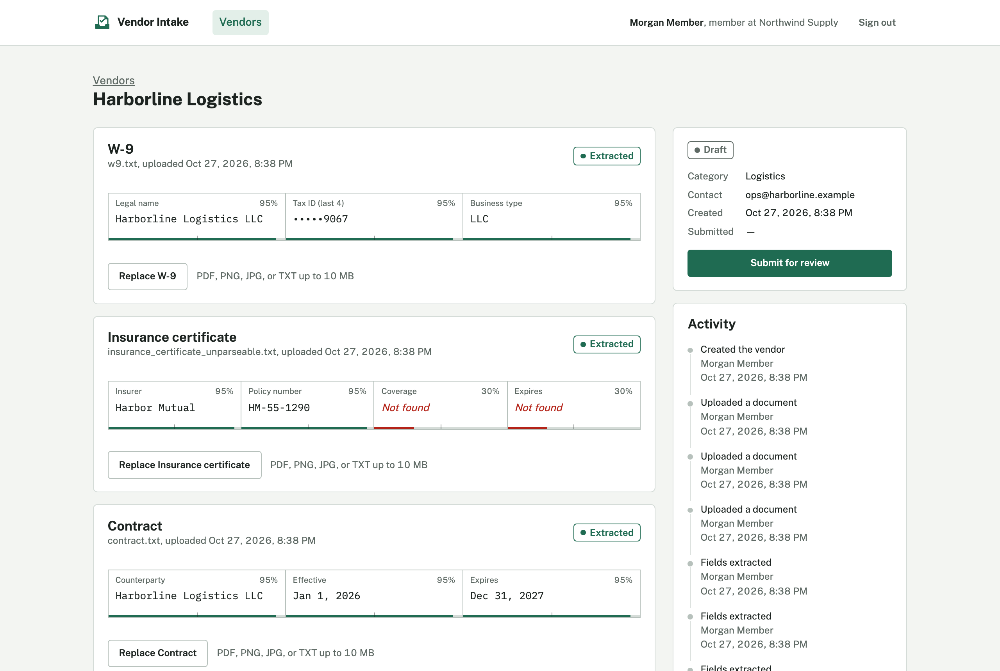
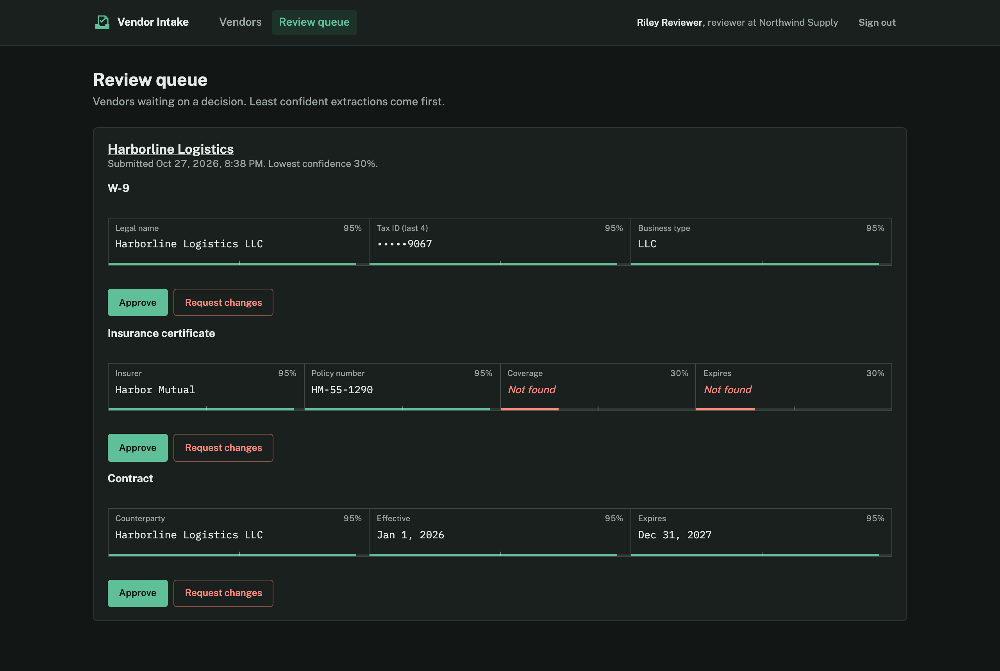

# Vendor Intake

A small vendor-onboarding app: teams upload a vendor's W-9, insurance certificate, and contract; fields are extracted with a confidence score per field; a reviewer approves each document or sends it back with a note. TypeScript frontend (Next.js), Python backend (FastAPI).



It exists as the **system under test** for an AI test-generation agent and its evaluation harness, so it's built the way a real product would be: specs first, tenant isolation on every query, an audit trail on every state change, and a test suite that runs in CI. API test coverage is deliberately thin. Filling it in from the Gherkin specs is the agent's job.

## Run it

**Docker** (needs Docker only):

```bash
make up          # http://localhost:3000 · API docs at http://localhost:8000/docs
```

**Locally** (needs [uv](https://docs.astral.sh/uv/) and the Node version in `.nvmrc`):

```bash
make install && npm ci --prefix frontend
make dev         # seeds demo data, runs API on :8000 and web on :3000
```

Demo accounts (password `demo-password`); the sign-in page has buttons to fill them in:

| Account | Role | Can |
|---|---|---|
| `member@northwind.test` | Member | Create vendors, upload documents, submit for review |
| `reviewer@northwind.test` | Reviewer | Everything a member can, plus approve or request changes |
| `member@globex.test` | Member, different tenant | Sees none of Northwind's data |

## How it works

| Layer | Choices |
|---|---|
| Specs | [`features/`](features/): Gherkin for auth, vendors, documents, review, audit. Backend tests cite the feature they cover. |
| API | FastAPI, SQLAlchemy 2, SQLite. 16 operations under `/api`, OpenAPI at `/docs`. |
| Data access | Repositories take `tenant_id` on every read; another tenant's record is indistinguishable from a missing one. |
| Errors | One envelope everywhere: `{"error": {"code", "message", ...}}`; validation errors name the field. |
| Extraction | Background job after upload. A deterministic stub parses `Key: Value` text files ([`samples/`](samples/)); unparseable values get low confidence and land at the top of the review queue. |
| Auth | Scrypt-hashed passwords, JWT in an HttpOnly `SameSite=Lax` cookie (bearer header also accepted). |
| Frontend | Next.js 16 App Router, React 19, TypeScript strict, plain CSS with design tokens, light and dark themes. |
| Contract | `openapi.json` is generated from the API; frontend types are generated from it. CI fails if either drifts. |



## Tests

| Suite | What | Run |
|---|---|---|
| Backend | 68 pytest tests, 97% coverage, ruff and mypy `--strict` | `make check` |
| UI | Playwright: sign-in, vendor CRUD, the member-to-reviewer journey, role and tenant access, axe accessibility scans | `make e2e` |
| API | Playwright request tests with persona fixtures ([`e2e/fixtures`](e2e/fixtures/index.ts)); intentionally minimal | `make e2e` |

`make e2e` starts both servers against a fresh seeded database. CI ([`.github/workflows/ci.yml`](.github/workflows/ci.yml)) runs a secret scan, backend checks, frontend type/lint/build, both drift checks, the Docker build, and the Playwright suite against a production build.

## Layout

```
backend/    FastAPI app (src/vendor_intake), pytest suite
frontend/   Next.js app; lib/api-schema.d.ts is generated
e2e/        Playwright api + ui projects
features/   Gherkin specs
samples/    Example documents for uploads
```

## Not in v1

Real OCR or model-based extraction, migrations (schema is created on startup), multi-instance storage, email notifications, editing vendor details in the UI (the API supports it).

## License

[MIT](LICENSE)
